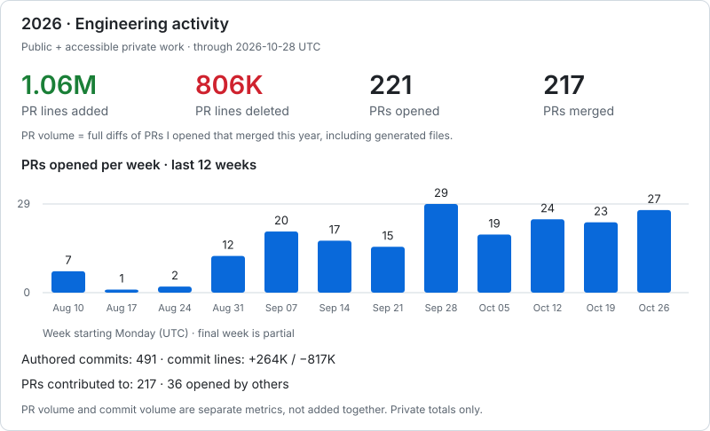
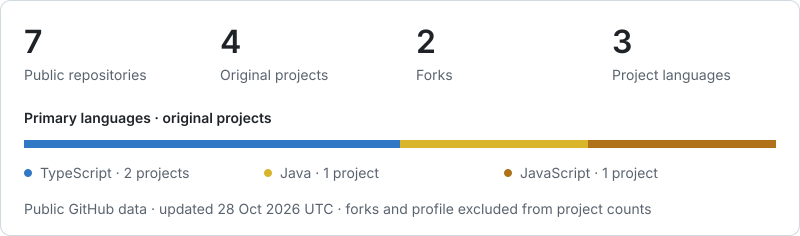

# Hi, I'm Noyan 👋

### Muhammad Noyan Aziz · Senior Software Engineer

I build full-stack products, workflow automation, and integrations—from backend APIs and cloud infrastructure to the interfaces people use every day.

[GitHub](https://github.com/NoyanAziz) · [Repositories](https://github.com/NoyanAziz?tab=repositories)

## Engineering activity

Lines added/deleted are the full diffs of PRs I authored that were **merged this calendar year (UTC)**. They include generated files and aren't a count of unique hand-written code. PRs opened are grouped by creation date; weekly counts start on Monday, with the current week partial. Totals cover only repositories accessible to the refresh token. Private work, when enabled, is shown only as anonymous aggregates.

## My work at a glance

These stats cover public repositories. Original projects exclude forks and this profile repository. Language counts use the primary language of each original project, rather than lines of code.

## Professional work

### 2U / edX · Ecommerce engineering

Completed edX's full discount migration from legacy Django Oscar to Commercetools, including program offers and coupons. Also contributed across checkout, order history, refunds, and order fulfillment, improved PayPal payment flows, and maintained integrations between legacy and newer commerce systems.

### Private product work

- **Workflow platforms:** Built project portals with approval flows, document management, notifications, reporting, and role-based access.
- **Voice & AI:** Developed English/Spanish daily-log workflows with voice capture, structured summaries, audit trails, and review before client visibility.
- **Payments & integrations:** Implemented payment and signing integrations, checkout recovery, refund reconciliation, and protected document delivery.
- **Cloud & delivery:** Built AWS infrastructure and CI/CD pipelines, with background workers, operational monitoring, and deployment reliability improvements.

<!-- GitHub displays its native contribution calendar below the profile content. -->
